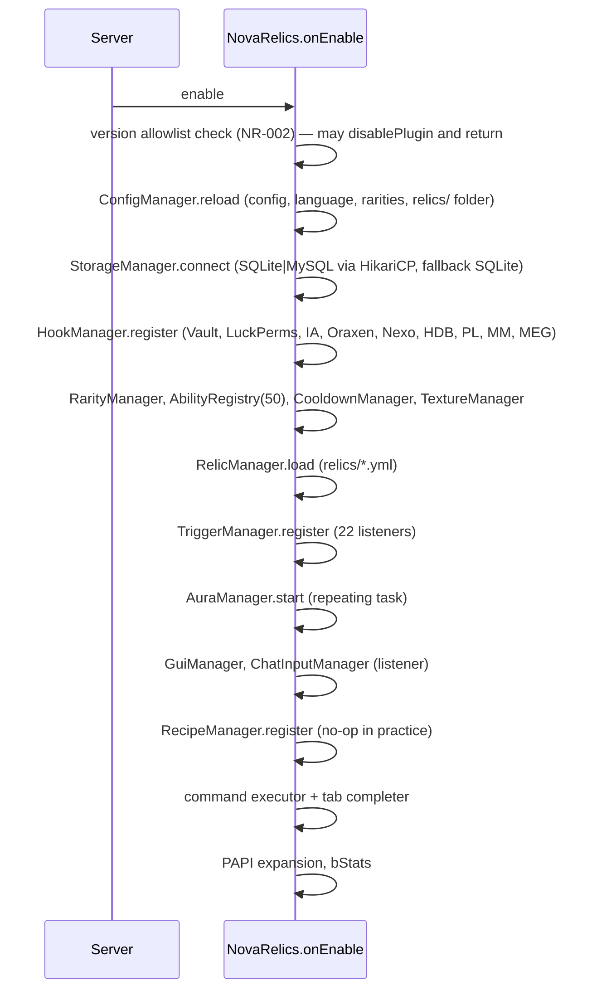
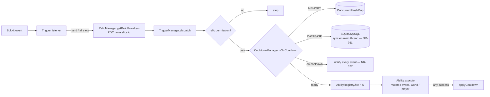
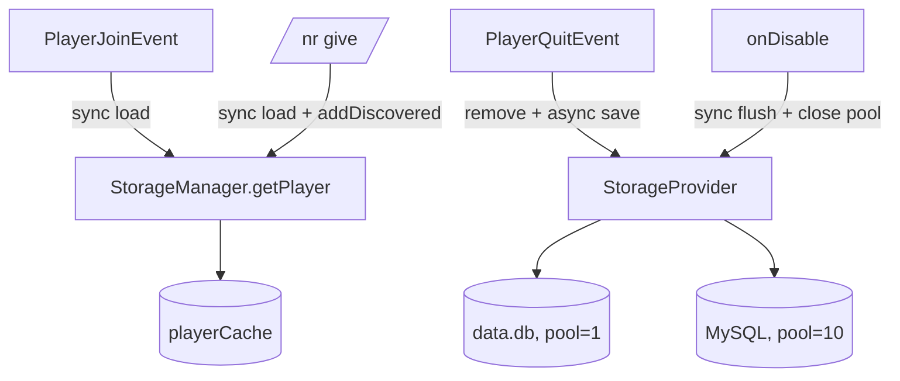

# Architecture Analysis

## Initialisation sequence

**Failure handling:** none of the steps is guarded. An exception in any constructor leaves earlier services half-initialised: for example, a `CureAbility` static-init failure on a renamed potion constant (NR-016) aborts `AbilityRegistry` after storage has already connected. `onDisable` null-checks only the aura, recipe and storage managers.

## Runtime data flow (trigger → ability)

## Persistence

## Shutdown
`onDisable` runs, in order: `auraManager.stop()`, `recipeManager.unregister()`, `storageManager.disconnect()`.

What it does **not** do:
- Cancel or complete pending one-shot tasks. Bukkit cancels them, so temporary flight, glow and cobwebs are never reverted (NR-020).
- Wait for async saves already queued, which can race the pool closing (NR-024).
- Unregister the PAPI expansion. This is acceptable because `persist()` is true and PAPI unregisters on disable.

## Coupling and design assessment

| Concern | Observation | Impact | Recommendation |
|---|---|---|---|
| God object / service locator | All classes receive the `NovaRelics` instance and reach through getters; utils use `NovaRelics.getInstance()` | Unit testing requires a full plugin. MockBukkit can handle that, but pure unit tests are hard. | Constructor-inject the 2–3 collaborators each class needs (incremental, no framework) |
| Listener ownership | TriggerManager registers listeners once; GUIs register a listener *per open* and unregister by handler list on close | Works, but leaks if close is never fired (crash or kick paths) | One global GUI listener that checks `InventoryHolder instanceof NovaGui` |
| Platform coupling | Paper/Adventure types used directly in core | Spigot incompatible (NR-003) | `Platform` interface (see API audit) |
| Persistence model | Mix of YAML (relics) and SQL (player, cooldowns, unused charges) | Fine | Remove or implement charges |
| Thread safety | Main thread only, except `ChatInputManager` (async event → `runTask` ✅) and `StorageManager` async saves (shared mutable `PlayerData` ⚠) | NR-024 | Snapshot data before async save |
| Circular dependencies | None between packages found (all point to root plugin) | — | — |
| Duplicated logic | `getAllRelicItems` (CommandTrigger) duplicates `dispatchFromAllSlots`; the two storage providers are ~90 % identical; knockback/pull/shockwave vector code repeated | Maintainability | Extract `AbstractJdbcProvider` (dialect-specific upsert only); `VectorUtil.awayFrom` |
| Version handling | String allowlist | NR-002 | Capability probes |

**No rewrite is recommended.** The architecture (registry of stateless abilities plus a trigger dispatcher) is sound and easy to extend. The issues are local and can be fixed incrementally.
